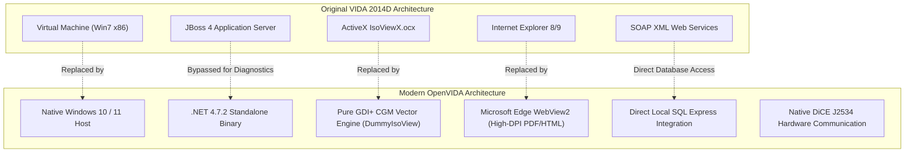
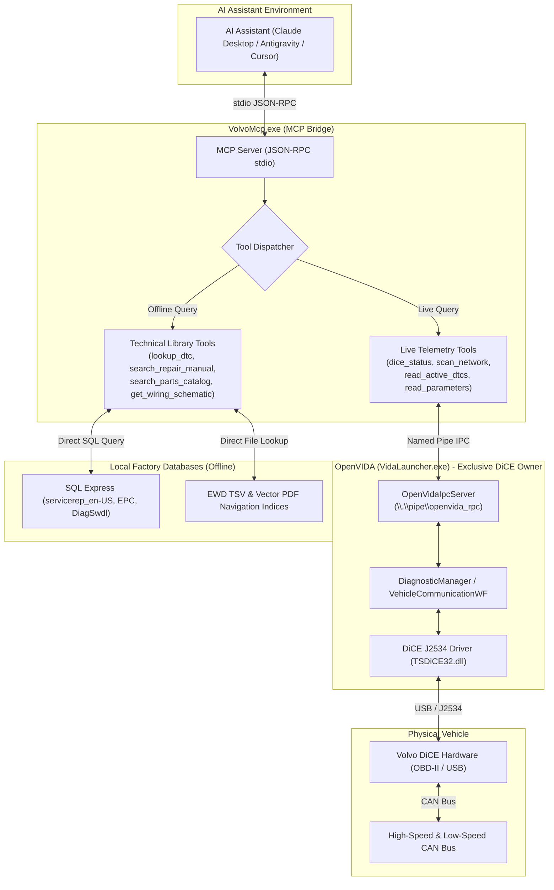

<p align="center">
  
</p>

<h1 align="center">OpenVIDA</h1>

<p align="center">
  <strong>A modern, standalone, native C# / .NET reimagining of Volvo VIDA 2014D</strong><br />
  <em>Liberated from Internet Explorer, virtual machines, and legacy browser plugins.</em>
</p>

<p align="center">
  
  
  
  
  
</p>

---

## 📖 Table of Contents
- [1. What is OpenVIDA?](#1-what-is-openvida)
- [2. Key Capabilities & The 5 Pillars](#2-key-capabilities--the-5-pillars)
- [3. Supported Vehicles & Hardware](#3-supported-vehicles--hardware)
- [4. Quick Start Guide](#4-quick-start-guide)
- [5. Building from Source](#5-building-from-source)
- [6. Model Context Protocol (MCP) AI Integration](#6-model-context-protocol-mcp-ai-integration)
- [7. Behind the Scenes: Modernizing Legacy VIDA](#7-behind-the-scenes-modernizing-legacy-vida)
- [8. Codebase & Project Architecture](#8-codebase--project-architecture)
- [9. Roadmap & Upcoming Milestones](#9-roadmap--upcoming-milestones)

---

## 1. What is OpenVIDA?

For more than a decade, owners and independent technicians maintaining Volvo vehicles from the 1999–2015 era (P1, P2, and P3 platforms) have had to rely on **Volvo VIDA 2014D**. 

Operating original VIDA in the modern era has become notoriously difficult:
- **The Legacy VM Trap**: Users were forced to spin up bloated 32-bit Windows 7 VirtualBox or VMware images just to launch a diagnostic session.
- **Internet Explorer 8/9 & ActiveX**: The original client was deeply coupled to obsolete ActiveX plugins (notably IsoView for vector graphics) and ancient Internet Explorer rendering engines that crash or refuse to load on modern Windows 10/11.
- **Complex Multi-Tier Stack**: Original VIDA ran a heavy JBoss/Java backend communicating through fragile SOAP proxies, slow database abstractions, and erratic session locks.

**OpenVIDA** liberates the system completely. It extracts the raw diagnostic core and business assemblies into a clean, standalone, native Windows Forms application with Microsoft Edge WebView2 rendering, a custom GDI+ CGM vector engine, direct SQL database integration, and high-performance DiCE J2534 CAN communication.

---

## 2. Key Capabilities & The 5 Pillars

```
+-------------------------------------------------------------------------------------------------+
|                                       OpenVIDA Workspace                                        |
+-------------------------------------------------------------------------------------------------+
|  [🚗 Initial State]  [🌐 Network]  [⚡ Vehicle Comm]  [📖 Ref Info]  [📚 Manuals]  [📦 Parts] ... |
+-------------------------------------------------------------------------------------------------+
```

### 📊 Pillar 1: Live Sensor Telemetry & Streaming
- **Multi-ECU Concurrent Polling**: Read and decode live CAN parameters simultaneously from engine (ECM), transmission (TCM), brakes (BCM), central electronics (CEM), and climate (CCM).
- **Auto-Scaling Graph View**: Live time-series plotter with dynamic 20% visual headroom padding to prevent clipping during sudden throttle or boost spikes.
- **Watchlist Controls**: Rapidly add and remove parameters with top-bar actions (`[❌ Remove Item]`, `[🗑️ Clear All]`), <kbd>Delete</kbd> keyboard shortcuts, or right-click context menus.
- **Battery & Key Position Monitoring**: Continuous real-time readout of terminal 30 battery voltage and ignition key position (Pos 0, Pos I, Pos II, Pos III).

### ⚡ Pillar 2: Bidirectional Actuators & Component Testing
- **Physical Relay & Solenoid Control**: Command vehicle components directly over DiCE J2534 (e.g., fuel flap solenoid, front & rear washer sprinklers, stop lights, windshield wipers, cooling fans).
- **Pre-Flight Prerequisite Verification**: Modern safety popup intercepts actuation triggers to warn the user of necessary preconditions (e.g., Key-On-Engine-Off vs. Key-On-Engine-Running, transmission in Park/Neutral, battery voltage thresholds) with `[▶️ Proceed]` and `[Cancel]` guards.
- **VehComm Sub-Tabs**: 1-click toggling between **📊 Parameters**, **⚡ Activations**, and **🔧 Advanced** (Special Tools & Adaptations).

### 🌐 Pillar 3: Interactive ECU Network Topology Map
- **Chassis Architecture Map**: Displays the full Volvo bus architecture (High-Speed CAN, Low-Speed CAN, and LIN subnetworks) across up to 36 onboard control modules.
- **Live Module Status Coloring**: Color-coded diagnostic health:
  - 🟢 **Green**: Module communicating normally, zero faults.
  - 🟠 **Orange / Red**: DTCs stored in non-volatile memory.
  - 🟡 **Yellow**: Intermittent communication or unconfirmed fault.
  - ⚪ **Gray**: Module not fitted or unpowered.
- **Interactive Filtering**: Clicking any ECU node on the vector map automatically filters the fault readout table.

### 📚 Pillar 4: Service & Workshop Repair Manuals
- **68,000+ Genuine Workshop Procedures**: Extracted and indexed directly from the `servicerep_en-US` database.
- **Volvo Function Group Hierarchy**: Navigable tree structured by genuine engineering function groups:
  - `0 - General`, `1 - Service & Maintenance`, `2 - Engine & Equipment`, `3 - Electrical`, `4 - Power Transmission`, `5 - Brakes`, `6 - Suspension & Steering`, `7 - Springs & Wheels`, `8 - Body & Interior`, `9 - Miscellaneous`.
- **Embedded Technical Diagrams**: Illustrations rendered cleanly in-line alongside procedure text, torques, and warning callouts.

### 📦 Pillar 5: Electronic Parts Catalog (EPC) & Wiring Diagrams (EWD)
- **150,000+ Parts Catalog (EPC)**: Full parts database with model/engine filters (e.g. V70 D5204T2), exploded component assemblies, callout numbers, Volvo part numbers, fitment notes, and 1-click clipboard copying.
- **Edge WebView2 Wiring Diagrams (EWD)**: Integrated official wiring diagrams from `Volvo_EWD_2014D.iso` featuring 680+ indexed electrical components (relays, fuses, splices, grounds, ECUs) with fast keyword search and high-DPI vector PDF rendering.

---

## 3. Supported Vehicles & Hardware

### Supported Hardware
- **Volvo DiCE (Diagnostic Communication Equipment)**: Genuine or high-quality clone hardware communicating over native USB (`dice_usb.dll` / J2534 PassThru).
- **Generic J2534 PassThru Interfaces**: Standard J2534 PassThru compliant devices.

### Supported Volvo Platforms
- **P3 Platform**: V70 (08-), XC70 (08-), S80 (07-), XC60 (-17), S60 (11-18), V60 (-18).
- **P2 Platform**: V70 (00-08), XC70 (01-07), S60 (01-09), S80 (99-06), XC90 (03-14).
- **P1 Platform**: C30 (07-13), C70 (06-13), S40 (04-12), V50 (04-12).

---

## 4. Quick Start Guide

### Prerequisites
1. **Operating System**: Windows 10 or Windows 11 (64-bit).
2. **Microsoft Edge WebView2 Runtime**: Pre-installed on modern Windows 10/11 (or downloadable from Microsoft).
3. **Microsoft SQL Server Express**: Local SQL Server instance hosting the standard VIDA databases (`BaseData`, `CarCom`, `EPC`, `DiagSwdlRepository`, `servicerep_en-US`).
4. **DiCE Driver**: Standard Volvo DiCE driver installed for USB connectivity.

### Running OpenVIDA
To launch OpenVIDA with automatic backend and database verification:
```cmd
run_diagnostics.bat
```
*The batch script verifies that SQL Server is active, ensures the local JBoss backend is initialized, and launches `VidaLauncher.exe` directly.*

### Running in Mock Simulation Mode (Desk Testing)
If you want to explore the interface, test DTC navigation, browse manuals, or inspect the parts catalog without being connected to a car:
```cmd
Vida.bat --mock
```

---

## 5. Building from Source

OpenVIDA is organized into clean, modular C# files inside [`src/`](src/) and can be compiled in seconds without requiring heavy IDE installations:

```cmd
build.bat
```

The build script invokes the native 32-bit Microsoft .NET Framework C# compiler (`csc.exe`):
1. **Compiles `DummyIsoView.dll`**: The custom GDI+ CGM vector network renderer.
2. **Compiles `VidaLauncher.exe`**: Incorporates all source modules in `src/`, links required references, and embeds the high-resolution `vida_icon.ico` directly into the Win32 binary.
3. **Compiles `VolvoMcp.exe`**: Builds the standalone Model Context Protocol (MCP) bridge in [`mcp/volvo-dice/`](mcp/volvo-dice/).

Alternatively, you can open and build the project in Visual Studio using [`src/OpenVida.csproj`](src/OpenVida.csproj).

---

## 6. Model Context Protocol (MCP) AI Integration

OpenVIDA includes a dedicated **Model Context Protocol (MCP)** server ([`VolvoMcp.exe`](mcp/volvo-dice/VolvoMcp.cs)) that connects modern AI assistants (such as Claude Desktop, Google Antigravity, Cursor, and ChatGPT MCP clients) directly to your Volvo vehicle and the factory VIDA technical knowledge base.

### What is it?
The [Model Context Protocol (MCP)](https://modelcontextprotocol.io/) is an open standard that allows large language models (LLMs) to securely access local tools, inspect data, and interact with desktop environments. The OpenVIDA MCP bridge turns your AI assistant into an expert Volvo Master Technician that can autonomously query vehicle telemetry, read Diagnostic Trouble Codes (DTCs), look up factory torque specs, locate parts in the EPC, and pinpoint wiring schematics in real time.

### Why is it useful?
- **AI-Guided Troubleshooting**: Instead of manually cross-referencing DTC codes across manuals, ask your AI assistant: *"My car threw ECM-2000 and CCM-0070. What are the common failure modes and what should I inspect first?"* The AI fetches the real DTC definitions, failure conditions, and factory test steps directly from the database.
- **Zero Hallucination with Grounded Data**: Torque values, wire colors, pinouts, and OEM part numbers are pulled directly from Volvo factory databases (`servicerep_en-US`, `EPC`, `DiagSwdlRepository`), ensuring factual diagnostic guidance.
- **Hardware Conflict-Free**: All physical communication with the DiCE interface is arbitrated through OpenVIDA to eliminate `ERR_DEVICE_IN_USE` hardware crashes.
- **Works 100% Offline for Research**: Even with no car connected and OpenVIDA closed, the technical library tools (DTC lookup, workshop procedures, parts catalog, wiring diagrams, VIN decoder) remain fully operational offline.

### How to use it

#### 1. Configure your MCP Client
Add the `volvo-dice` server definition to your client configuration file (e.g. `claude_desktop_config.json` or `mcp_config.json`):

```json
{
  "mcpServers": {
    "volvo-dice": {
      "command": "C:\\path\\to\\vida\\mcp\\volvo-dice\\VolvoMcp.exe",
      "args": []
    }
  }
}
```

#### 2. Available MCP Tools

##### 🔌 Live Vehicle Diagnostics (Powered via OpenVIDA IPC)
*Requires `VidaLauncher.exe` running with DiCE connected (or in Mock mode). If OpenVIDA is not running, the tool provides a friendly prompt reminding you to launch it.*

| Tool | Parameters | Description |
| :--- | :--- | :--- |
| **`dice_status`** | *None* | Checks physical DiCE connection, real-time terminal 30 battery voltage (mV and V), ignition key position, and profile. |
| **`scan_network`** | *None* | Scans HS-CAN (500 kbps) and LS-CAN (125 kbps) buses for all responding ECUs (ECM, TCM, BCM, CEM, DIM, CCM, REM, etc.). |
| **`read_active_dtcs`** | *None* | Reads currently active Diagnostic Trouble Codes (DTCs), fault states (Permanent / Intermittent), and ECU sources directly from the car. |
| **`read_parameters`** | `ecu` *(optional, e.g. "ECM", "CCM", "BCM")* | Streams real-time ECU live sensor data (RPM, coolant temperature, mass air flow, throttle angle, damper angles, wheel speeds). |

##### 📚 Factory Technical Library & Knowledge Base (100% Offline)
*Direct SQL Server Express & TSV index integration. Runs with sub-millisecond response times whether OpenVIDA is open or closed.*

| Tool | Parameters | Description |
| :--- | :--- | :--- |
| **`lookup_dtc`** | `code` *(required)*, `language` *(optional)* | Searches factory knowledge base for DTC definitions, root causes, trigger conditions, and CarCom symptoms. |
| **`search_repair_manual`** | `query` *(required)*, `limit` *(optional)* | Searches 68,000+ official Volvo workshop procedures by keyword (e.g. *"timing belt"*, *"alternator replacement"*). |
| **`get_repair_document`** | `document_id` *(required)* | Retrieves full step-by-step repair instructions, tightening torque specifications, and safety warnings by Document ID. |
| **`get_wiring_schematic`** | `component` *(required)*, `publication_id` *(optional)* | Searches Electronic Wiring Diagrams (EWD) by component name or code (e.g. `1/1` Battery, `10/1` Alternator, `4/56` CEM) returning both electrical schematic and physical placement pages. |
| **`search_parts_catalog`** | `query` *(required)*, `limit` *(optional)* | Searches the Electronic Parts Catalog (`EPC`) database for official Volvo part numbers, descriptions, unit types, and assembly groups. |
| **`decode_vin`** | `vin` *(required)* | Decodes 17-character Volvo VINs into vehicle model series, model year, assembly plant, and serial number. |
| **`list_ecus`** | `query` *(optional)* | Lists standard Volvo ECU abbreviations, full names, and system functions. |

#### 3. Example Conversations with your AI Assistant
- *"What is my battery voltage and are any trouble codes currently active in my Volvo?"*
- *"Look up trouble code ECM-2000 and show me the repair instructions for replacing the sensor."*
- *"Search the parts catalog for front brake pads and discs for my V70, and list the Volvo part numbers."*
- *"Find the wiring diagram for the alternator control module (ACM) in publication 39180202 and tell me which pages to check."*

---

## 7. Behind the Scenes: Modernizing Legacy VIDA

Building OpenVIDA required deep reverse-engineering of the legacy Volvo diagnostic suite. Below are the key engineering breakthroughs that made this standalone architecture possible:



### 1. Reverse-Engineering CGM & Replacing ActiveX IsoView
Original VIDA relied on a proprietary 1990s ActiveX control (`IsoViewX.ocx`) to render the interactive vehicle network diagram. In modern Windows and outside Internet Explorer, this control causes access violations, hangs, and memory corruption.

By analyzing the binary **CGM (Computer Graphics Metafile)** format used by Volvo (`v70_diesel_0920.cgm`), we constructed **`DummyIsoView`**:
- Implements the COM event interfaces (`_DIsoViewX`, `_DIsoViewXEvents`).
- Parses CGM element classes (Drawing primitives, Polylines, Text, Application Data markers).
- Employs double-buffered GDI+ rendering to draw the vehicle chassis, bus routes, and interactive ECU nodes with hover effects and click interception.

### 2. Eliminating the ProgressControler Thread-Race Crash
Original VIDA suffered from a critical race condition: during ECU scanning and communications, `ProgressControler` would dispatch status updates across threads without ensuring the underlying Windows Forms handle was created, triggering fatal `InvalidOperationException` or `TargetInvocationException` crashes.

OpenVIDA introduces **`SafeProgressListener`** and **`SafeListenerList`**:
- Intercepts listeners before registration.
- Wraps all progress, message, and busy-bar notifications with safe marshaling checks (`InvokeRequired`).
- Catches and drops asynchronous UI disposal exceptions cleanly.

### 3. Liberating Diagnostics from Browser Frames
Original VIDA ran inside an HTML `<frame>` wrapper, orchestrating diagnostics via JavaScript-to-ActiveX bridges. OpenVIDA instantiates `DiagnosticMainForm` directly inside a modern Windows Forms workspace:
- Wires custom tab activation controllers (`ITabActivation`).
- Injects a responsive modern top toolbar and tab bar with high-legibility Segoe UI typography.
- Solves locale-specific formatting bugs (such as Swedish comma delimiters displaying `12.3V` as `125.0V`).

### 4. Direct SQL & XML-to-HTML Technical Document Pipeline
Rather than relying on sluggish SOAP requests to fetch repair procedures, OpenVIDA connects directly to `servicerep_en-US` and `DiagSwdlRepository`:
- Resolves symptom codes and DTC IDs directly to Information Element (IE) records.
- Converts proprietary Volvo SGML/XML markup into modern, responsive HTML with custom CSS.
- Automatically extracts and base64-inlines technical schematic diagrams (`.png`/`.cgm`).

### 5. How It Works: Unified MCP Architecture & Named Pipe IPC (Single Hardware Owner Model)

Connecting external AI assistants directly to physical automotive hardware introduces a critical concurrency challenge: the SAE J2534 PassThru standard and Volvo's `TSDiCE32.dll` driver are strictly **single-client**. If an external process attempts to open the DiCE USB handle while `VidaLauncher` is communicating with the vehicle, the driver returns `ERR_DEVICE_IN_USE` (Error 8), locking the device or crashing the diagnostic session.

OpenVIDA resolves this with a **Single Exclusive Hardware Owner** architecture powered by local Windows Named Pipe IPC:



#### Dual-Path Execution Model
1. **Live Car Path (Arbitrated via IPC)**:
   - When the AI invokes `dice_status`, `scan_network`, `read_active_dtcs`, or `read_parameters`, `VolvoMcp.exe` connects to the local Windows Named Pipe `\\.\pipe\openvida_rpc` hosted by [`OpenVidaIpcServer.cs`](src/Core/OpenVidaIpcServer.cs).
   - `VidaLauncher` streams live telemetry, active DTCs, and network status directly from its active in-memory session without relinquishing the physical DiCE J2534 hardware lock.
   - If `VidaLauncher` is closed, `VolvoMcp.exe` intercepts the call and returns an informative prompt guiding the user to start OpenVIDA, completely avoiding device contention or unhandled exceptions.

2. **Technical Library Path (Direct & 100% Offline)**:
   - When the AI invokes `lookup_dtc`, `search_repair_manual`, `get_repair_document`, `get_wiring_schematic`, `search_parts_catalog`, `decode_vin`, or `list_ecus`, `VolvoMcp.exe` queries the local SQL Express databases and EWD navigation tables directly.
   - Queries execute with sub-millisecond latency and require neither an active car connection nor `VidaLauncher` to be running.

---

## 8. Codebase & Project Architecture

The codebase is cleanly separated into focused modules under [`src/`](src/) and [`mcp/`](mcp/):

```
vida/
├── assets/                          # Branding & icons (.vectorcraft, .svg, .png, .ico)
├── ewd/                             # Extracted Electronic Wiring Diagram schematics
├── mcp/                             # Model Context Protocol (MCP) server
│   └── volvo-dice/                  # Standalone MCP bridge server
│       ├── VolvoMcp.cs              # Dual-path MCP bridge (Named Pipe IPC + offline SQL)
│       └── VolvoMcp.exe             # Compiled MCP executable
├── src/                             # Modular C# source code
│   ├── OpenVida.csproj              # MSBuild project definition
│   ├── Program.cs                   # Entry point, CLI args, shell layout, navigation
│   ├── Core/                        # Core runtime infrastructure
│   │   ├── OpenVidaIpcServer.cs     # Named Pipe IPC server (\\.\pipe\openvida_rpc)
│   │   ├── SafeProgressListener.cs  # Thread-safe UI progress listeners
│   │   ├── FallbackHashtable.cs     # Fault-tolerant localization lookup
│   │   ├── ReflectionHelpers.cs     # Assembly inspection & reflection helpers
│   │   └── ScriptingContext.cs      # Scripting engine & hotspot wire-up
│   ├── Hardware/                    # Hardware communication & safety
│   │   ├── CarStatusManager.cs      # DiCE status polling (VBatt, Key Position)
│   │   └── ActuationPreflightDialog.cs # Pre-actuation prerequisite verification
│   ├── Diagnostics/                 # Diagnostic sessions & vehicle readout
│   │   ├── DiagnosticsLoader.cs     # DiagApplication initialization & session binding
│   │   └── VehicleReadoutHandler.cs # All-ECU fault readout & DTC processing
│   ├── Documents/                   # Documentation & rendering engine
│   │   ├── DocumentResolver.cs      # Symptom & DTC to document ID mapper
│   │   ├── DocumentHtmlRenderer.cs  # XML-to-HTML parser with inline images & notes
│   │   ├── DocumentViewerWindow.cs  # Standalone documentation viewer dialog
│   │   └── DtcExtendedDialogModernizer.cs # Enhanced DTC timeline & freeze-frame viewer
│   ├── Tabs/                        # Feature tab implementations
│   │   ├── TabControls.cs           # Common panel wrappers & models
│   │   ├── VehicleCommTab.cs        # Sensor streaming, activations, graph plotter
│   │   ├── ServiceManualsTab.cs     # Genuine Workshop Repair Manuals (Function Groups 0-9)
│   │   ├── PartsCatalogTab.cs       # Electronic Parts Catalog (EPC)
│   │   └── WiringDiagramsTab.cs     # Edge WebView2 Wiring Diagram viewer
│   ├── Testing/                     # Automated regression testing
│   │   └── AutomatedTestRunner.cs   # Visual round-trip screenshot regression runner
│   └── IsoView/                     # Vector graphics subsystem
│       └── DummyIsoView.cs          # Native GDI+ CGM vector network map
├── build.bat                        # 1-click native compiler (VidaLauncher + VolvoMcp)
├── run_diagnostics.bat              # Service checker and application launcher
└── README.md                        # Documentation
```

---

## 9. Roadmap & Upcoming Milestones

- [x] **Live CAN Sensor Streaming**: Real-time parameter streaming from vehicle ECUs with auto-scaling graph view.
- [x] **Bidirectional Actuations**: Tested on vehicle hardware (fuel flap, wipers, washers, stop lights).
- [x] **Pre-Flight Prerequisites Verification**: Interactive safety warnings for KOEO/KOER requirements.
- [x] **Electronic Parts Catalog (EPC)**: Full parts database with model filtering and exploded diagrams.
- [x] **Electronic Wiring Diagrams (EWD)**: High-DPI vector PDF rendering via Edge WebView2.
- [x] **Brand Visual Identity**: Custom vector emblem and Windows icon integration via VectorCraft.
- [x] **Codebase Modularization**: Clean split into `src/` modular components with `OpenVida.csproj`.
- [x] **MCP Server Evolution & In-App IPC Integration**: Built in-app Named Pipe server and unified Volvo MCP bridge connecting AI assistants to live car telemetry and offline factory data.
- [ ] **Startup JBoss Service Verification**: Health probe checking backend readiness at launch with auto-start prompts.
- [ ] **All-ECU DTC Clear ("Clear All Faults")**: In-car verification of DTC clearing routine over DiCE.
- [ ] **Service Reset & Adaptations**: SRI reset, Battery Monitoring Sensor (BMS) reset, transmission adaptation counters.
- [ ] **Automated Windows Installer**: Packaging into a turnkey setup wizard (Inno Setup / WiX).

---

<p align="center">
  <em>Developed with ❤️ for the Volvo enthusiast and engineering community.</em>
</p>
