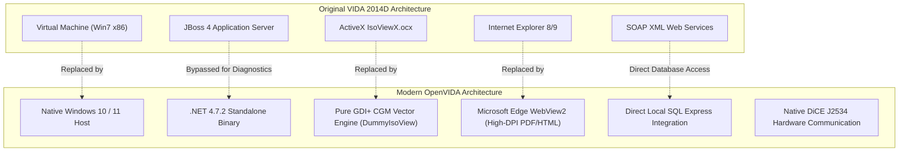

<p align="center">
  
</p>

<h1 align="center">OpenVIDA</h1>

<p align="center">
  <strong>A modern, standalone, native C# / .NET reimagining of Volvo VIDA 2014D</strong><br />
  <em>Liberated from Internet Explorer, virtual machines, and legacy browser plugins.</em>
</p>

<p align="center">
  
  
  
  
  
</p>

---

## 📖 Table of Contents
- [1. What is OpenVIDA?](#1-what-is-openvida)
- [2. Key Capabilities & The 6 Pillars](#2-key-capabilities--the-6-pillars)
- [3. Supported Vehicles & Hardware](#3-supported-vehicles--hardware)
- [4. Installation, Setup Wizard & Quick Start](#4-installation-setup-wizard--quick-start)
- [5. Building from Source](#5-building-from-source)
- [6. Model Context Protocol (MCP) AI Integration](#6-model-context-protocol-mcp-ai-integration)
- [7. Behind the Scenes: Modernizing Legacy VIDA](#7-behind-the-scenes-modernizing-legacy-vida)
- [8. Codebase & Project Architecture](#8-codebase--project-architecture)
- [9. Roadmap & Upcoming Milestones](#9-roadmap--upcoming-milestones)

---

## 1. What is OpenVIDA?

For more than a decade, owners and independent technicians maintaining Volvo vehicles from the 1999–2015 era (P1, P2, and P3 platforms) have had to rely on **Volvo VIDA 2014D**. 

Operating original VIDA in the modern era has become notoriously difficult:
- **The Legacy VM Trap**: Users were forced to spin up bloated 32-bit Windows 7 VirtualBox or VMware images just to launch a diagnostic session.
- **Internet Explorer 8/9 & ActiveX**: The original client was deeply coupled to obsolete ActiveX plugins (notably IsoView for vector graphics) and ancient Internet Explorer rendering engines that crash or refuse to load on modern Windows 10/11.
- **Complex Multi-Tier Stack**: Original VIDA ran a heavy JBoss/Java backend communicating through fragile SOAP proxies, slow database abstractions, and erratic session locks.

**OpenVIDA** liberates the system completely. It extracts the raw diagnostic core and business assemblies into a clean, standalone, native Windows Forms application with Microsoft Edge WebView2 rendering, a custom GDI+ CGM vector engine, direct SQL database integration, high-performance DiCE J2534 CAN communication, and a **first-of-its-kind Model Context Protocol (MCP) AI bridge** that gives AI coding and reasoning agents live access to your car's CAN bus and the entire Volvo factory technical library.

---

## 2. Key Capabilities & The 6 Pillars

```
+----------------------------------------------------------------------------------------------------------+
|                                           OpenVIDA Workspace                                             |
+----------------------------------------------------------------------------------------------------------+
| [🚗 Initial State] [🌐 Network] [⚡ Vehicle Comm] [📖 Ref Info] [📚 Manuals] [📦 Parts] [⚡ EWD]  ⇄ 🤖 MCP |
+----------------------------------------------------------------------------------------------------------+
```

### 📊 Pillar 1: Live Sensor Telemetry & Streaming
- **Multi-ECU Concurrent Polling**: Read and decode live CAN parameters simultaneously from engine (ECM), transmission (TCM), brakes (BCM), central electronics (CEM), and climate (CCM).
- **Auto-Scaling Graph View**: Live time-series plotter with dynamic 20% visual headroom padding to prevent clipping during sudden throttle or boost spikes.
- **Watchlist Controls**: Rapidly add and remove parameters with top-bar actions (`[❌ Remove Item]`, `[🗑️ Clear All]`), <kbd>Delete</kbd> keyboard shortcuts, or right-click context menus.
- **Battery & Key Position Monitoring**: Continuous real-time readout of terminal 30 battery voltage and ignition key position (Pos 0, Pos I, Pos II, Pos III).

### ⚡ Pillar 2: Bidirectional Actuators & Component Testing
- **Physical Relay & Solenoid Control**: Command vehicle components directly over DiCE J2534 (e.g., fuel flap solenoid, front & rear washer sprinklers, stop lights, windshield wipers, cooling fans).
- **Pre-Flight Prerequisite Verification**: Modern safety popup intercepts actuation triggers to warn the user of necessary preconditions (e.g., Key-On-Engine-Off vs. Key-On-Engine-Running, transmission in Park/Neutral, battery voltage thresholds) with `[▶️ Proceed]` and `[Cancel]` guards.
- **VehComm Sub-Tabs**: 1-click toggling between **📊 Parameters**, **⚡ Activations**, and **🔧 Advanced** (Special Tools & Adaptations).

### 🌐 Pillar 3: Interactive ECU Network Topology Map
- **Chassis Architecture Map**: Displays the full bus architecture (High-Speed CAN, Low-Speed CAN, and LIN subnetworks) across up to 36 onboard control modules.
- **Live Module Status Coloring**: Color-coded diagnostic health:
  - 🟢 **Green**: Module communicating normally, zero faults.
  - 🟠 **Orange / Red**: DTCs stored in non-volatile memory.
  - 🟡 **Yellow**: Intermittent communication or unconfirmed fault.
  - ⚪ **Gray**: Module not fitted or unpowered.
- **Interactive Filtering**: Clicking any ECU node on the vector map automatically filters the fault readout table.

### 📚 Pillar 4: Service & Workshop Repair Manuals
- **68,000+ Genuine Workshop Procedures**: Extracted and indexed directly from the `servicerep_en-US` database.
- **Volvo Function Group Hierarchy**: Navigable tree structured by genuine engineering function groups:
  - `0 - General`, `1 - Service & Maintenance`, `2 - Engine & Equipment`, `3 - Electrical`, `4 - Power Transmission`, `5 - Brakes`, `6 - Suspension & Steering`, `7 - Springs & Wheels`, `8 - Body & Interior`, `9 - Miscellaneous`.
- **Embedded Technical Diagrams**: Illustrations rendered cleanly in-line alongside procedure text, torques, and warning callouts.

### 📦 Pillar 5: Electronic Parts Catalog (EPC) & Wiring Diagrams (EWD)
- **150,000+ Parts Catalog (EPC)**: Full parts database with model/engine filters (e.g. V70 D5204T2), exploded component assemblies, callout numbers, Volvo part numbers, fitment notes, and 1-click clipboard copying.
- **Edge WebView2 Wiring Diagrams (EWD)**: Integrated official wiring diagrams from `Volvo_EWD_2014D.iso` featuring 680+ indexed electrical components across all 54 publications (relays, fuses, splices, grounds, ECUs) with fast keyword search and high-DPI vector SVG/PDF rendering.

### 🤖 Pillar 6: AI Diagnostic Co-Pilot via Model Context Protocol (MCP)
- **Live CAN Bus + Factory Knowledge in One AI Loop**: Connects AI agents (Claude Desktop, Google Antigravity, Cursor, Windsurf, etc.) directly to the running OpenVIDA diagnostic session over a Named Pipe IPC bridge (`\\.\pipe\openvida_rpc`) and to the 9 local SQL Server databases.
- **Closed-Loop Interactive Troubleshooting**: Your AI assistant doesn't just guess — it can read active DTCs from the car, sample live ECU parameters before and after you rev the engine or actuate a switch, pull the exact factory fault-tracing procedure, trace the circuit in the Electronic Wiring Diagrams, and hand you the OEM replacement part number and tightening torques.
- **Hardware-Safe Arbitration**: All DiCE J2534 bus operations are routed through the running `VidaLauncher.exe` session so you can watch the OpenVIDA GUI and talk to your AI agent simultaneously without USB lock collisions.

---

## 3. Supported Vehicles & Hardware

### Supported Hardware
- **Volvo DiCE (Diagnostic Communication Equipment)**: Genuine or high-quality clone hardware communicating over native USB (`dice_usb.dll` / J2534 PassThru).
- **Generic J2534 PassThru Interfaces**: Standard J2534 PassThru compliant devices.

### Supported Volvo Platforms
- **P3 Platform**: V70 (08-), XC70 (08-), S80 (07-), XC60 (-17), S60 (11-18), V60 (-18).
- **P2 Platform**: V70 (00-08), XC70 (01-07), S60 (01-09), S80 (99-06), XC90 (03-14).
- **P1 Platform**: C30 (07-13), C70 (06-13), S40 (04-12), V50 (04-12).

---

## 4. Installation, Setup Wizard & Quick Start

OpenVIDA uses a **"Bring Your Own Data"** installation model via a single, self-contained **~4 MB Windows Setup Wizard (`OpenVidaSetup.exe`)**. 

All OpenVIDA native binaries (`VidaLauncher.exe`, `DummyIsoView.dll`, `VidaMcp.exe`), the embedded extraction engine (`7z.exe` + `7z.dll`), the signed 64-bit Volvo DiCE USB driver, and the pre-indexed 54-publication EWD component navigation tables (`assets/ewd_nav_index.zip`) are compiled directly inside `OpenVidaSetup.exe`. You only need to point the installer to your VIDA 2014D data source and (optionally) the Electronic Wiring Diagrams archive.

### Step-by-Step Setup Procedure (`OpenVidaSetup.exe`)

Run **`OpenVidaSetup.exe`** (running as Administrator is recommended so the installer can stage the 64-bit DiCE USB driver and configure SQL Server TCP/IP registry settings):

#### Step 1: System Prerequisites Check
The wizard automatically probes your system and displays live status indicators for:
1. **.NET Framework 4.x Runtime**: Built into Windows 10 and Windows 11.
2. **Microsoft Edge WebView2 Runtime**: Required for high-DPI vector PDF rendering in the Electronic Wiring Diagrams tab (includes a 1-click download button if missing).
3. **Microsoft SQL Server Express (`localhost\SQLEXPRESS`)**: Hosts the 9 Volvo relational databases (includes a 1-click download link to the free Microsoft SQL Server Express installer if not yet installed).
4. **Administrator Privileges**: Indicates whether the wizard has elevation to stage kernel drivers and configure `HKLM` registry keys.

#### Step 2: Target Directory, Data Sources & Options
Configure where OpenVIDA should be installed and select your data sources:

1. **Target Installation Directory**:
   - Defaults to `C:\OpenVIDA` (or any custom path you choose).
2. **VIDA 2014D Data Source (Required)**:
   - The installer supports three different input formats out of the box:
     - **Option A — Portable Data Archive (`.7z`, `.zip`, `.rar`)**: Point to an `OpenVIDA_Data_2014D.7z` archive created by `pack_data.bat` (or any compressed archive of the `VIDA\` directory).
     - **Option B — VirtualBox Appliance (`Win7-x86-Vida.ova` or `.vmdk`)**: Point directly to the common VIDA 2014D VirtualBox `.ova` or `.vmdk` image. Using its bundled `7z.exe` engine, the installer automatically opens the virtual disk partition and extracts the `VIDA\` directory and all 9 SQL databases without needing VirtualBox installed.
     - **Option C — Existing `VIDA` Folder**: Point to an already unpacked `VIDA\` folder on your disk or external drive containing `db\`, `jboss\`, and `jdk\`.
3. **Electronic Wiring Diagrams Source (Optional)**:
   - Point to **`Volvo_EWD_2014D.iso`**, the multi-part **`Volvo_EWD_2014D.part1.rar`** archive, or an already extracted **`US_Eng`** folder.
   - During installation, the wizard extracts the `US_Eng` schematics and automatically overlays OpenVIDA's pre-indexed component schematic and placement page tables (`assets/ewd_nav_index.zip`) across all 54 publications.
   - **Skipping EWD**: You can leave this field blank if you do not have or need the wiring diagrams. OpenVIDA will install normally and automatically **grey out (disable) the `⚡ WIRING DIAGRAMS` button** in the top navigation bar.
4. **Installation & Configuration Checkboxes**:
   - **`[x] Install Volvo DiCE 64-bit USB Driver & J2534 Interface`**:
     - When **checked** (default): Stages and installs the bundled, signed 64-bit (`amd64`) Volvo DiCE USB driver (`DiCE\Tools\Driver_amd64\DiceUsb.inf`) into the Windows DriverStore via `pnputil.exe` and writes the SAE J2534-1 PassThru registry entries (`SETEK - DiCE` and `DiCE-206751`) pointing to `TSDiCE32.dll`.
     - When **unchecked**: Skips the DiCE driver and J2534 registry setup so you can use another compatible SAE J2534 PassThru interface without conflict.
   - **`[x] Create Desktop Shortcut (`OpenVIDA Diagnostics`)`**
   - **`[x] Create Start Menu Program Shortcut`**

#### Step 3: Automated Validation, Extraction, SQL Attachment & Logging
When you click **Install Now ⚡**, the wizard performs a 7-stage automated deployment:
1. **Core Payload Deployment**: Unpacks the embedded OpenVIDA binaries, tools, and scripts into the target folder.
2. **Pre-Flight Structural Content Verification**: Before unpacking multi-gigabyte files, the wizard inspects the selected folder or archive headers to verify that required VIDA database files (`BaseData_Data.MDF`, `CarComRT_Data.MDF`) and EWD assets (`US_Eng` / `pdf-links.js`) are actually present. If an unrelated archive or folder was selected, it stops immediately with a clear explanation.
3. **VIDA Runtime & Database Extraction**: Copies or extracts the VIDA runtime and database files with real-time console output.
4. **Native Patch Overlay**: Overlays `VidaLauncher.exe`, `DummyIsoView.dll`, `VidaMcp.exe`, and `components.config.xml` (no legacy 2050 web license patch is needed because `VidaLauncher.exe` connects directly to SQL Server and bypasses the legacy web login).
5. **EWD Extraction & Component Indexing**: Extracts `US_Eng` (if selected) and unpacks the 54-publication `*_nav.tsv` index.
6. **Automated SQL Server Express Configuration**:
   - Starts the `MSSQL$SQLEXPRESS` service if stopped.
   - Enables Mixed Mode Authentication (`LoginMode = 2`) and static TCP/IP port `1433`.
   - Attaches all 9 VIDA databases (`BaseData`, `EPC`, `AccessServer`, `DiagSwdlRepository`, `CarCom`, `DiagSwdlSession`, `DiceTiming`, `imagerepository`, `servicerep_en-US`) from `<TargetDir>\VIDA\db\`.
   - Creates and maps the `ASUser` and `PPUsers` logins (`db_owner`) across all 9 databases and applies the `DiagSwdlSession.dbo.Dtc` nullable `fkEcuInfoId` schema fix.
7. **COM, Driver & Shortcut Registration**: Registers `DummyIsoView.dll` in `HKCU\Software\Classes\CLSID` (eliminating IsoView ActiveX errors), installs the 64-bit DiCE driver (if checked), and creates Desktop/Start Menu shortcuts.

> **Persistent Setup Logging & Error Diagnostics (`OpenVidaSetup.log`)**  
> Every command, file operation, SQL query, and error trace is written in real time to **`<TargetDir>\OpenVidaSetup.log`** (and mirrored in `%TEMP%\OpenVidaSetup.log`). Both the installation progress screen and completion screen include a **`[📄 Open Setup Log]`** button, and if any error occurs during installation, the wizard presents a clear diagnostic message and offers to open `OpenVidaSetup.log` directly in Notepad.

---

### Packing a Portable VIDA Data Archive (`pack_data.bat`)

If you already have a working OpenVIDA installation and want to package its `VIDA\` folder into a single clean archive (`OpenVIDA_Data_2014D.7z`) for backup or installing on another PC:

```cmd
pack_data.bat "D:\Backups\OpenVIDA_Data_2014D.7z"
```
- The script temporarily takes the 9 SQL Server databases `OFFLINE` so SQL Server flushes and releases all `.mdf`/`.ldf` file locks, compresses the `VIDA\` folder using `tools\7z.exe` (excluding temporary log files and excluding `wiring_diagrams` by default so `Volvo_EWD_2014D.iso` can be kept separate), and immediately brings all 9 databases back `ONLINE`.
- To bundle the extracted Electronic Wiring Diagrams inside the same archive, pass `--include-ewd` as the second argument:
  ```cmd
  pack_data.bat "D:\Backups\OpenVIDA_Data_2014D_Full.7z" --include-ewd
  ```

---

### Launching OpenVIDA & Mock Mode
- **Desktop / Start Menu**: Double-click the **OpenVIDA Diagnostics** shortcut (or run `VidaLauncher.exe`).
- **Service Checker Batch Launcher**: Run `run_diagnostics.bat` to verify SQL Server responsiveness and launch `VidaLauncher.exe`.
- **Mock Simulation Mode (Desk Testing without a Vehicle)**:
  ```cmd
  Vida.bat --mock
  ```

### Uninstalling OpenVIDA
OpenVIDA includes a built-in GUI & CLI uninstaller that cleanly stops background services and releases database file locks before removing the installation folder:
- **Option 1 — Windows Settings (Installed Apps)**: Open **Windows Settings → Apps → Installed apps**, find **OpenVIDA Diagnostics (Volvo VIDA 2014D)**, and click **Uninstall**.
- **Option 2 — From the Installation Folder**: Double-click **`<TargetDir>\OpenVidaUninstall.exe`** or **`<TargetDir>\uninstall.bat`**.
- **Option 3 — Command Line / Silent Uninstall**:
  ```cmd
  OpenVidaSetup.exe --uninstall "C:\OpenVIDA" --quiet
  ```
The uninstaller automatically terminates any running `VidaLauncher.exe` and JBoss (`java.exe`) processes, detaches any SQL Server databases mounted from `<TargetDir>\VIDA\db`, removes Desktop/Start Menu shortcuts and registry entries, and deletes `<TargetDir>`.

---

## 5. Building from Source

OpenVIDA is organized into clean, modular C# files inside [`src/`](src/) and can be compiled in seconds without requiring heavy IDE installations:

```cmd
build.bat
```

The build script invokes the native Microsoft .NET Framework C# compiler (`csc.exe`) in four steps:
1. **`[1/4]` Compiles `DummyIsoView.dll`**: The custom GDI+ CGM vector network renderer.
2. **`[2/4]` Compiles `VidaLauncher.exe`**: Incorporates all source modules in `src/`, links required references, and embeds `vida_icon.ico`.
3. **`[3/4]` Compiles `VidaMcp.exe`**: Builds the standalone Model Context Protocol (MCP) bridge in [`mcp/vida-mcp/`](mcp/vida-mcp/).
4. **`[4/4]` Packages Payload & Compiles `OpenVidaSetup.exe`**: Bundles all OpenVIDA binaries, `7z.exe`/`7z.dll`, `DiCE\Tools\Driver_amd64`, and `assets/ewd_nav_index.zip` into an embedded payload and compiles the standalone Windows Setup Wizard ([`src/Installer/OpenVidaSetup.cs`](src/Installer/OpenVidaSetup.cs)).

Alternatively, you can open and build the project in Visual Studio using [`src/OpenVida.csproj`](src/OpenVida.csproj).

---

## 6. Model Context Protocol (MCP) AI Integration

OpenVIDA includes a dedicated **Model Context Protocol (MCP)** server ([`VidaMcp.exe`](mcp/vida-mcp/VidaMcp.cs)) that connects modern AI assistants (such as Claude Desktop, Google Antigravity, Cursor, and ChatGPT MCP clients) directly to your Volvo vehicle and the factory VIDA technical knowledge base.

### What is it?
The [Model Context Protocol (MCP)](https://modelcontextprotocol.io/) is an open standard that allows large language models (LLMs) to securely access local tools, inspect data, and interact with desktop environments. The OpenVIDA MCP bridge turns your AI assistant into an expert Volvo Master Technician that can autonomously query vehicle telemetry, read Diagnostic Trouble Codes (DTCs), look up factory torque specs, locate parts in the EPC, and pinpoint wiring schematics in real time.

### Why is it useful?
- **AI-Guided Troubleshooting**: Instead of manually cross-referencing DTC codes across manuals, ask your AI assistant: *"My car threw ECM-2000 and CCM-0070. What are the common failure modes and what should I inspect first?"* The AI fetches the real DTC definitions, failure conditions, and factory test steps directly from the database.
- **Zero Hallucination with Grounded Data**: Torque values, wire colors, pinouts, and OEM part numbers are pulled directly from Volvo factory databases (`servicerep_en-US`, `EPC`, `DiagSwdlRepository`), ensuring factual diagnostic guidance.
- **Hardware Conflict-Free**: All physical communication with the DiCE interface is arbitrated through OpenVIDA to eliminate `ERR_DEVICE_IN_USE` hardware crashes.
- **Works 100% Offline for Research**: Even with no car connected and OpenVIDA closed, the technical library tools (DTC lookup, workshop procedures, parts catalog, wiring diagrams, VIN decoder) remain fully operational offline.

### How to use it

#### 1. Configure your MCP Client
Add the `vida-mcp` server definition to your client configuration file (e.g. `claude_desktop_config.json` or `mcp_config.json`):

```json
{
  "mcpServers": {
    "vida-mcp": {
      "command": "C:\\OpenVIDA\\mcp\\vida-mcp\\VidaMcp.exe",
      "args": []
    }
  }
}
```

#### 2. Available MCP Tools

##### 🔌 Live Vehicle Diagnostics (Powered via OpenVIDA IPC)
*Requires `VidaLauncher.exe` running with DiCE connected (or in Mock mode). If OpenVIDA is not running, the tool provides a friendly prompt reminding you to launch it.*

| Tool | Parameters | Description |
| :--- | :--- | :--- |
| **`dice_status`** | *None* | Checks physical DiCE connection, real-time terminal 30 battery voltage (mV and V), ignition key position, and profile. |
| **`scan_network`** | *None* | Scans HS-CAN (500 kbps) and LS-CAN (125 kbps) buses for all responding ECUs (ECM, TCM, BCM, CEM, DIM, CCM, REM, etc.). |
| **`read_active_dtcs`** | *None* | Reads currently active Diagnostic Trouble Codes (DTCs), fault states (Permanent / Intermittent), and ECU sources directly from the car. |
| **`read_parameters`** | `ecu` *(optional, e.g. "ECM", "CCM", "BCM")* | Streams real-time ECU live sensor data (RPM, coolant temperature, mass air flow, throttle angle, damper angles, wheel speeds). |

##### 📚 Factory Technical Library & Knowledge Base (100% Offline)
*Direct SQL Server Express & TSV index integration. Runs with sub-millisecond response times whether OpenVIDA is open or closed.*

| Tool | Parameters | Description |
| :--- | :--- | :--- |
| **`lookup_dtc`** | `code` *(required)*, `language` *(optional)* | Searches factory knowledge base for DTC definitions, root causes, trigger conditions, and CarCom symptoms. |
| **`search_repair_manual`** | `query` *(required)*, `limit` *(optional)* | Searches 68,000+ official Volvo workshop procedures by keyword (e.g. *"timing belt"*, *"alternator replacement"*). |
| **`get_repair_document`** | `document_id` *(required)* | Retrieves full step-by-step repair instructions, tightening torque specifications, and safety warnings by Document ID. |
| **`get_wiring_schematic`** | `component` *(required)*, `publication_id` *(optional)* | Searches Electronic Wiring Diagrams (EWD) by component name or code (e.g. `1/1` Battery, `10/1` Alternator, `4/56` CEM) returning both electrical schematic and physical placement pages. |
| **`search_parts_catalog`** | `query` *(required)*, `limit` *(optional)* | Searches the Electronic Parts Catalog (`EPC`) database for official Volvo part numbers, descriptions, unit types, and assembly groups. |
| **`decode_vin`** | `vin` *(required)* | Decodes 17-character Volvo VINs into vehicle model series, model year, assembly plant, and serial number. |
| **`list_ecus`** | `query` *(optional)* | Lists standard Volvo ECU abbreviations, full names, and system functions. |

#### 3. Example Prompts & Interactive Troubleshooting Workflows

Because `vida-mcp` bridges **live vehicle telemetry** with the **offline factory databases**, you can run interactive, multi-step diagnostic sessions with your AI assistant right from the driver's seat or workshop bench:

##### 📈 Scenario A: Live Sensor Measurements & Interactive Stimulus Testing
Instead of staring at raw numbers on a laptop screen while trying to operate pedals or test under the hood, ask the AI to sample live parameters before and after a physical action:
- **Charging & Cranking Voltage Drop Test**:
  > *"Check `dice_status` and `read_parameters` on the ECM right now with the engine off and record the resting battery voltage. Tell me when you're ready, then I'll start the engine and you can read it again to verify if the alternator (ACM) is regulating properly around 14.2V–14.5V."*
- **Live Boost, MAF & Throttle Correlation**:
  > *"Read the live ECM parameters while I'm idling, and then take another reading while I hold the engine at 2,500 RPM. Compare the Mass Air Flow (MAF), Throttle Angle, and Intake Air Temp values against normal factory expectations for a D5 diesel."*
- **Interactive Brake / Wheel Speed Sensor Check**:
  > *"Poll the live parameters from the Brake Control Module (BCM). I'm going to spin the front-left wheel by hand on the lift — check whether the front-left wheel speed reading responds or stays stuck at 0 km/h."*
- **HVAC Damper Motor Sweep Verification**:
  > *"Read the live parameters on the Climate Control Module (CCM). Look at the temperature and defroster damper motor positions, and tell me if any damper is stuck out of range when I switch from full cold to full heat."*

##### 🔍 Scenario B: End-to-End DTC Triage (Fault Code → Live Data → Wiring → Repair → Part Number)
Let the AI chain multiple tools automatically in a single prompt to go from a symptom to a complete repair plan:
- **Full Diagnostic Triage in One Prompt**:
  > *"Scan the vehicle for all active DTCs. For every Permanent fault code you find: (1) look up its factory DTC definition and trigger conditions, (2) read the relevant ECU's live parameters to see if the sensor value is currently implausible, (3) find the component in the Electronic Wiring Diagrams (`39180202`) with its schematic and connector placement pages, and (4) pull the workshop replacement procedure and OEM part number."*
- **Chasing a Parasitic Draw or Charging Fault**:
  > *"My car has stored CEM-1A53 (Communication with Alternator Control Module missing). Check the current battery voltage via DiCE, look up CEM-1A53 in the VIDA database, find the LIN bus wiring schematic between CEM (`4/56`) and the Alternator (`6/26`), and tell me which pin and wire color I should probe with my multimeter."*

##### 🌐 Scenario C: CAN Bus Network & "No-Crank / No-Comms" Diagnosis
When a module drops off the bus or the car won't start:
- **Bus Topology & Missing ECU Isolation**:
  > *"Run `scan_network` and `dice_status` to see which ECUs are responding on HS-CAN and LS-CAN and what key position the CEM sees. If any module is missing or reporting bus-off faults, check the wiring diagram for the CAN splice blocks and tell me where the physical splice is located in the car."*

##### 🔧 Scenario D: Offline Bench Research & Maintenance Planning (No Vehicle Connected)
Even at your desk inside the house with the car parked outside, all database and schematic tools run 100% offline:
- **Pre-Job Torque & Part Number Sheet**:
  > *"I'm planning to replace the timing belt, auxiliary belt tensioner, and water pump on my 2011 Volvo V70 D5 (VIN `YV1BW5251B1189886`). Decode the VIN, pull the official VIDA step-by-step removal and installation instructions, extract every tightening torque in Nm, and list the genuine Volvo OEM part numbers from the EPC."*
- **Pinout & Ground Location Lookup**:
  > *"Where is the physical ground point for the fuel pump and Rear Electronic Module (REM) on a 2011 V70? Search the EWD schematics and give me both the circuit page and the 3D harness placement page."*

---

## 7. Behind the Scenes: Modernizing Legacy VIDA

Building OpenVIDA required deep reverse-engineering of the legacy Volvo diagnostic suite. Below are the key engineering breakthroughs that made this standalone architecture possible:



### 1. Reverse-Engineering CGM & Replacing ActiveX IsoView
Original VIDA relied on a proprietary 1990s ActiveX control (`IsoViewX.ocx`) to render the interactive vehicle network diagram. In modern Windows and outside Internet Explorer, this control causes access violations, hangs, and memory corruption.

By analyzing the binary **CGM (Computer Graphics Metafile)** format used by Volvo (`v70_diesel_0920.cgm`), we constructed **`DummyIsoView`**:
- Implements the COM event interfaces (`_DIsoViewX`, `_DIsoViewXEvents`).
- Parses CGM element classes (Drawing primitives, Polylines, Text, Application Data markers).
- Employs double-buffered GDI+ rendering to draw the vehicle chassis, bus routes, and interactive ECU nodes with hover effects and click interception.

### 2. Eliminating the ProgressControler Thread-Race Crash
Original VIDA suffered from a critical race condition: during ECU scanning and communications, `ProgressControler` would dispatch status updates across threads without ensuring the underlying Windows Forms handle was created, triggering fatal `InvalidOperationException` or `TargetInvocationException` crashes.

OpenVIDA introduces **`SafeProgressListener`** and **`SafeListenerList`**:
- Intercepts listeners before registration.
- Wraps all progress, message, and busy-bar notifications with safe marshaling checks (`InvokeRequired`).
- Catches and drops asynchronous UI disposal exceptions cleanly.

### 3. Liberating Diagnostics from Browser Frames
Original VIDA ran inside an HTML `<frame>` wrapper, orchestrating diagnostics via JavaScript-to-ActiveX bridges. OpenVIDA instantiates `DiagnosticMainForm` directly inside a modern Windows Forms workspace:
- Wires custom tab activation controllers (`ITabActivation`).
- Injects a responsive modern top toolbar and tab bar with high-legibility Segoe UI typography.
- Solves locale-specific formatting bugs (such as Swedish comma delimiters displaying `12.3V` as `125.0V`).

### 4. Direct SQL & XML-to-HTML Technical Document Pipeline
Rather than relying on sluggish SOAP requests to fetch repair procedures, OpenVIDA connects directly to `servicerep_en-US` and `DiagSwdlRepository`:
- Resolves symptom codes and DTC IDs directly to Information Element (IE) records.
- Converts proprietary Volvo SGML/XML markup into modern, responsive HTML with custom CSS.
- Automatically extracts and base64-inlines technical schematic diagrams (`.png`/`.cgm`).

### 5. How It Works: Unified MCP Architecture & Named Pipe IPC (Single Hardware Owner Model)

Connecting external AI assistants directly to physical automotive hardware introduces a critical concurrency challenge: the SAE J2534 PassThru standard and Volvo's `TSDiCE32.dll` driver are strictly **single-client**. If an external process attempts to open the DiCE USB handle while `VidaLauncher` is communicating with the vehicle, the driver returns `ERR_DEVICE_IN_USE` (Error 8), locking the device or crashing the diagnostic session.

OpenVIDA resolves this with a **Single Exclusive Hardware Owner** architecture powered by local Windows Named Pipe IPC:


#### Dual-Path Execution Model
1. **Live Car Path (Arbitrated via IPC)**:
   - When the AI invokes `dice_status`, `scan_network`, `read_active_dtcs`, or `read_parameters`, `VidaMcp.exe` connects to the local Windows Named Pipe `\\.\pipe\openvida_rpc` hosted by [`OpenVidaIpcServer.cs`](src/Core/OpenVidaIpcServer.cs).
   - `VidaLauncher` streams live telemetry, active DTCs, and network status directly from its active in-memory session without relinquishing the physical DiCE J2534 hardware lock.
   - If `VidaLauncher` is closed, `VidaMcp.exe` intercepts the call and returns an informative prompt guiding the user to start OpenVIDA, completely avoiding device contention or unhandled exceptions.

2. **Technical Library Path (Direct & 100% Offline)**:
   - When the AI invokes `lookup_dtc`, `search_repair_manual`, `get_repair_document`, `get_wiring_schematic`, `search_parts_catalog`, `decode_vin`, or `list_ecus`, `VidaMcp.exe` queries the local SQL Express databases and EWD navigation tables directly.
   - Queries execute with sub-millisecond latency and require neither an active car connection nor `VidaLauncher` to be running.

---

## 8. Codebase & Project Architecture

The codebase is cleanly separated into focused modules under [`src/`](src/) and [`mcp/`](mcp/):

```
openvida/
├── assets/                          # Branding, icons (.vectorcraft, .svg, .png, .ico) & ewd_nav_index.zip
├── DiCE/                            # J2534 PassThru tools & signed 64-bit DiCE USB driver (Driver_amd64)
├── mcp/                             # Model Context Protocol (MCP) server
│   └── vida-mcp/                    # Standalone MCP bridge server
│       ├── VidaMcp.cs               # Dual-path MCP bridge (Named Pipe IPC + offline SQL)
│       └── VidaMcp.exe              # Compiled MCP executable
├── src/                             # Modular C# source code
│   ├── OpenVida.csproj              # MSBuild project definition
│   ├── Program.cs                   # Entry point, CLI args, shell layout, navigation
│   ├── Core/                        # Core runtime infrastructure
│   │   ├── OpenVidaIpcServer.cs     # Named Pipe IPC server (\\.\pipe\openvida_rpc)
│   │   ├── StartupHealthCheck.cs    # Pre-flight SQL, JBoss & WebView2 health sentinel
│   │   ├── SafeProgressListener.cs  # Thread-safe UI progress listeners
│   │   ├── FallbackHashtable.cs     # Fault-tolerant localization lookup
│   │   ├── ReflectionHelpers.cs     # Assembly inspection & reflection helpers
│   │   └── ScriptingContext.cs      # Scripting engine & hotspot wire-up
│   ├── Hardware/                    # Hardware communication & safety
│   │   ├── CarStatusManager.cs      # DiCE status polling (VBatt, Key Position)
│   │   └── ActuationPreflightDialog.cs # Pre-actuation prerequisite verification
│   ├── Diagnostics/                 # Diagnostic sessions & vehicle readout
│   │   ├── DiagnosticsLoader.cs     # DiagApplication initialization & session binding
│   │   └── VehicleReadoutHandler.cs # All-ECU fault readout & DTC processing
│   ├── Documents/                   # Documentation & rendering engine
│   │   ├── DocumentResolver.cs      # Symptom & DTC to document ID mapper
│   │   ├── DocumentHtmlRenderer.cs  # XML-to-HTML parser with inline images & notes
│   │   ├── DocumentViewerWindow.cs  # Standalone documentation viewer dialog
│   │   └── DtcExtendedDialogModernizer.cs # Enhanced DTC timeline & freeze-frame viewer
│   ├── Tabs/                        # Feature tab implementations
│   │   ├── TabControls.cs           # Common panel wrappers & models
│   │   ├── VehicleCommTab.cs        # Sensor streaming, activations, programmed values, graph plotter
│   │   ├── ServiceManualsTab.cs     # Genuine Workshop Repair Manuals (Function Groups 0-9)
│   │   ├── PartsCatalogTab.cs       # Electronic Parts Catalog (EPC)
│   │   └── WiringDiagramsTab.cs     # Edge WebView2 Wiring Diagram viewer
│   ├── Installer/                   # Standalone Windows Setup Wizard
│   │   └── OpenVidaSetup.cs         # Self-contained 4-step Setup Wizard & SQL configurator
│   ├── Testing/                     # Automated regression testing
│   │   └── AutomatedTestRunner.cs   # Visual round-trip screenshot regression runner
│   └── IsoView/                     # Vector graphics subsystem
│       └── DummyIsoView.cs          # Native GDI+ CGM vector network map
├── build.bat                        # 1-click native compiler (VidaLauncher + VidaMcp + OpenVidaSetup)
├── pack_data.bat                    # Prerequisite VIDA data archive packer (.7z)
├── run_diagnostics.bat              # Service checker and application launcher
├── OpenVidaSetup.exe                # Compiled standalone Windows Setup Wizard
└── README.md                        # Documentation
```

---

## 9. Roadmap & Upcoming Milestones

- [x] **Live CAN Sensor Streaming**: Real-time parameter streaming from vehicle ECUs with auto-scaling graph view.
- [x] **Bidirectional Actuations**: Tested on vehicle hardware (fuel flap, wipers, washers, stop lights).
- [x] **Pre-Flight Prerequisites Verification**: Interactive safety warnings for KOEO/KOER requirements.
- [x] **Electronic Parts Catalog (EPC)**: Full parts database with model filtering and exploded diagrams.
- [x] **Electronic Wiring Diagrams (EWD)**: High-DPI vector PDF rendering via Edge WebView2 with 54-publication component navigation index.
- [x] **Brand Visual Identity**: Custom vector emblem and Windows icon integration via VectorCraft.
- [x] **Codebase Modularization**: Clean split into `src/` modular components with `OpenVida.csproj`.
- [x] **Startup JBoss & SQL Service Health Probe**: Health sentinel checking database and backend readiness at launch with auto-recovery prompts.
- [x] **MCP Server Evolution & In-App IPC Integration**: Built in-app Named Pipe server and unified Volvo MCP bridge connecting AI assistants to live car telemetry and offline factory data.
- [x] **Standalone Windows Installer (`OpenVidaSetup.exe`)**: Turnkey 4-step Windows Setup Wizard with "Bring Your Own Data" archive/OVA/folder extraction, automated SQL Server database attachment, bundled 64-bit DiCE USB driver installation, persistent logging (`OpenVidaSetup.log`), and `pack_data.bat`.
- [x] **Responsive Layout & Small Screen Audit**: Consolidated top status bar into single row with compact DiCE connect toggle; eliminated 450px of unused right boxes; removed redundant 28px legacy gray navigation ribbon across all tabs.
- [x] **Diagnostic Readout Export & Backup (`readouts/`)**: Dual-format export of complete vehicle diagnostics in human-readable `.json` and native Volvo DRO `.xml` (`<Dro Version="1.0">`) with 1-click `[📁 Readouts]` top-bar button and auto-export on scan.
- [x] **Post-Mortem Logging & Community Guidelines (`logs/`, `CONTRIBUTING.md`)**: Centralized rolling log system (`logs/openvida.log`), automated crash dump reports (`logs/crash_*.log`), in-app `[📋 Logs]` button, contribution guidelines, and GitHub issue templates encouraging AI coding assistant collaboration and alternative J2534 adapter testing.
- [ ] **All-ECU DTC Clear ("Clear All Faults")**: In-car verification of DTC clearing routine over DiCE.
- [ ] **Service Reset & Adaptations**: SRI reset, Battery Monitoring Sensor (BMS) reset, transmission adaptation counters.

---

## 10. Contributing, Community & Hardware Support

OpenVIDA is in **active Community Technical Preview (Alpha)**. We welcome contributions from Volvo owners, independent mechanics, and software developers!

- 📖 **Contribution Guidelines**: Read [`CONTRIBUTING.md`](CONTRIBUTING.md) for code conventions, C# 4.0 architecture, and PR guidelines.
- 🔌 **Alternative J2534 Adapters**: We actively encourage testing and compatibility reports for non-DiCE adapters (**Tactrix OpenPort 2.0**, **Scanmatik 2**, **VXDIAG VCX Nano**, **Mongoose JLR**).
- 🤖 **AI-Assisted Contributions**: Feel free to use AI coding assistants (**Google Antigravity**, **Claude**, **ChatGPT**, **GitHub Copilot**) when exploring code, debugging, or submitting bug reports and pull requests!
- 📋 **Logs & Crash Reports**: Find diagnostic logs anytime in `logs/openvida.log` or by clicking **`[📋 Logs]`** in OpenVIDA's top toolbar.

---

<p align="center">
  <em>Developed with ❤️ for the Volvo enthusiast and engineering community.</em>
</p>
