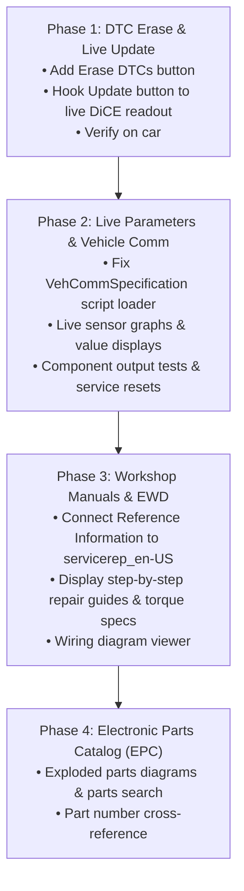

# Volvo VIDA Native Standalone — Implementation & Test Plan

> [!NOTE]
> All core databases (`BaseData`, `EPC`, `CarCom`, `DiagSwdlRepository`, `DiagSwdlSession`, `imagerepository`, `servicerep_en-US`) and .NET business/diagnostic engines are installed and running locally on Windows 11 without any virtual machines or Internet Explorer.

---

## 1. Current Status (What is Fully Working Today)

| Component | Status | Verification / Artifact |
| :--- | :--- | :--- |
| **DiCE USB Communication** | ✅ **Working** | Communicates over native USB (`dice_usb.dll` / J2534) to read car ECUs directly. |
| **Vehicle Identification & Decoding** | ✅ **Working** | Decodes VIN `YV1BW5251B1189886`, MY 2011 V70, D5204T2 diesel, M66 manual, profile `0b00c8af84add183`. |
| **All-ECU DTC Readout & Storage** | ✅ **Working** | Extracted and stored all 13 active DTCs (`ECM`, `CEM`, `HCM`, `FSM`) with freeze-frame timestamps into `DiagSwdlSession`. |
| **Offline Diagnostic Viewer** | ✅ **Working** | Loads all 13 DTCs without car connected; resolves 20 Customer Symptoms (CSC) in English with status ranks. |
| **DTC Timelines & Details** | ✅ **Working** | Displays occurrence timelines and freeze-frame details when selecting any fault code. |
| **ECU Vehicle Network Overview Map** | ✅ **Working** | Real-time GDI+ CGM vector renderer displays the V70 chassis outline, CAN/LIN buses, and 36 ECU modules with live status coloring (Green = OK, Red/Orange = Fault, Yellow = Intermittent, Gray = Inactive). |
| **Interactive Map Filtering** | ✅ **Working** | Clicking an ECU module on the vehicle map filters the fault list to that specific module. |
| **4-Tab Navigation UI** | ✅ **Working** | Native WinForms shell hosting `FAULT TRACE`, `NETWORK`, `VEHICLE COMM`, and `REFERENCE INFO`. |

---

## 2. Gap Analysis: Missing & Untested Functionality

### Area A: Diagnostics & DTC Management
- **DTC Erase / Clear Faults ("Erase All")**:
  - *Status*: Untested with the vehicle. The DiCE CarCom protocol for clearing codes exists in the DLLs, but needs a trigger button hooked up and tested on the car.
  - *Goal*: User can press "Erase DTCs", DiCE sends clear command to all ECUs, and the vehicle map turns green.
- **DTC Live Update ("Update" button)**:
  - *Status*: The UI button exists, but currently needs live re-execution of the CarCom readout pipeline without restarting the launcher.

### Area B: Vehicle Communication (Live Data & Actuator Activations)
- **Live Sensor Streams & Parameters**:
  - *Status*: Switching to the `VEHICLE COMM` tab encountered a `ScriptMissingException` (`Scripttype: 'VehCommSpecification'`).
  - *Goal*: Allow selecting any ECU (e.g. `ECM`, `CEM`, `BCM`) to view live real-time parameters:
    - Engine: coolant temperature, boost pressure, fuel rail pressure, MAF, DPF soot loading, battery voltage.
    - Transmission / Brakes: individual wheel speeds, steering angle, lateral acceleration.
- **Component Activations (Bidirectional Output Tests)**:
  - *Status*: Not yet exposed in native UI.
  - *Goal*: Send commands to turn on the fuel pump, cycle EGR valve, test cooling fan speeds, command headlight levelling motors, cycle wipers.
- **Service Calibrations & Adaptations**:
  - *Status*: Not yet exposed.
  - *Goal*: Service functions such as:
    - Electronic Parking Brake (EPB) service mode (retract calipers for pad replacement).
    - DPF forced service regeneration.
    - Battery Monitor Sensor (BMS) reset after battery replacement.
    - Brake hydraulic system bleeding procedure.

### Area C: Reference Information (Repair Manuals & Wiring Diagrams)
- **Service & Repair Manuals**:
  - *Status*: Database `servicerep_en-US` is present locally with all workshop repair documents, component replacement steps, and torque specifications.
  - *Goal*: Viewing pane inside `REFERENCE INFORMATION` to read procedural repair guides for the active DTCs.
- **Electronic Wiring Diagrams (EWD)**:
  - *Status*: Schematics and connector pinouts exist in local graphics/documentation repositories.

### Area D: Electronic Parts Catalog (EPC)
- **Parts Catalog & Diagrams**:
  - *Status*: Database `EPC` and exploded parts drawings in `imagerepository` are present.
  - *Goal*: Search part numbers, browse assembly diagrams, check part supersede history.

---

## 3. Do We Need the Windows 7 VM?

> [!IMPORTANT]
> **Short answer: No, you do not need to spend time fixing the Windows 7 VM.**

- **Why**: All databases (`BaseData`, `EPC`, `CarCom`, `DiagSwdlRepository`, `DiagSwdlSession`, `imagerepository`, `servicerep_en-US`), business logic, and communication libraries are installed directly on your Windows 11 machine. We can read all tables, stored procedures, and bytecode directly.
- **The only scenario where the VM is slightly helpful**: If we want to capture a visual baseline of a very specific obscure sub-menu to mirror its exact layout. Even then, we can inspect the original UI forms in `UI.DLL` and `GuiComponents.DLL` without running the VM.

---

## 4. Where Your Help Will Be Needed (Testing on the Car)

| Test Task | Car State | Description |
| :--- | :--- | :--- |
| **Offline Verification** | 🏠 Desk / Offline | You can verify all DTCs, symptom ranks, vehicle network maps, and repair information comfortably at your desk. |
| **DTC Erase Test** | 🚗 Connected (Ignition ON, Engine OFF) | Triggering "Erase DTCs" to test clearing faults across all ECUs via DiCE. |
| **Live Readout Update** | 🚗 Connected (Ignition ON) | Clicking "Update" to verify fresh communication and updated fault lists. |
| **Live Parameters (Veh Comm)** | 🚗 Connected (Engine ON / Running) | Viewing live engine sensor readings (coolant temp, RPM, rail pressure) to verify live streaming. |
| **Actuator & Service Tests** | 🚗 Connected (Ignition ON, Engine OFF) | Testing EPB service retraction or component toggles. |

---

## 5. Proposed 4-Phase Roadmap

### Next Decision:
Which phase or specific capability would you like to prioritize next?
1. **Phase 1: DTC Erase & Live Update** (Clear the 13 codes and verify live refresh with DiCE).
2. **Phase 2: Live Vehicle Communication** (Fix the script loader to see live engine parameters like boost, temperatures, voltages).
3. **Phase 3: Workshop Manuals & Wiring Diagrams** (View repair instructions & torque specs for the current 13 DTCs).
